<picture>
  <source media="(prefers-color-scheme: dark)" srcset="assets/banner-dark.svg">
  
</picture>

Third-year Software Engineering student at the University of Science, VNU-HCM.
I build across the stack, from RAG pipelines and Flutter apps to C++ games.

- **Highlights:** Top 7/100 at MongoDB Hackathon (team) · GDGoC Hackathon 2026
- **Now:** machine-learning coursework

<picture>
  <source media="(prefers-color-scheme: dark)" srcset="https://skillicons.dev/icons?i=py,ts,js,flutter,cpp,mongodb&theme=dark">
  
</picture>

Reach me: [Email](mailto:iamhuy29062006@gmail.com) · [LinkedIn](https://www.linkedin.com/in/thaiquanghuy2906/)
